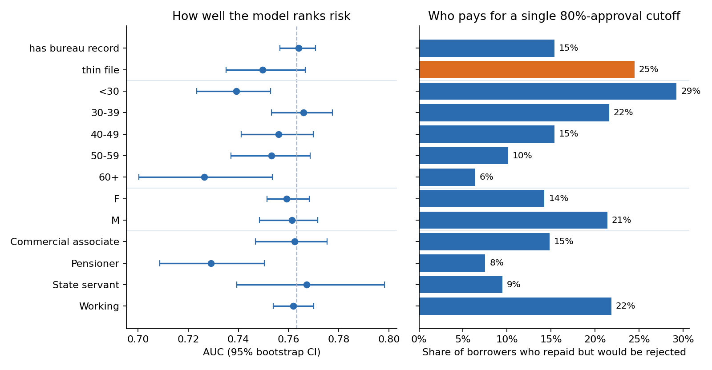
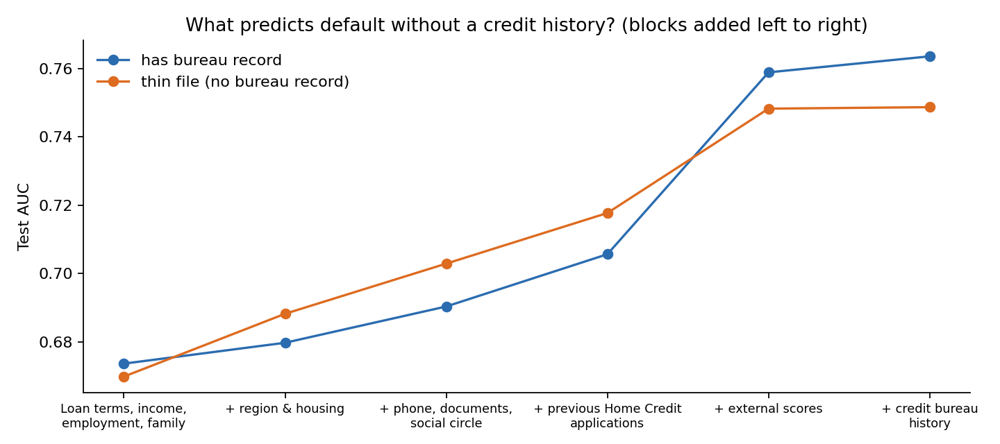

# Credit scoring for borrowers with no credit history

Lenders who serve people outside the formal credit system have to score applicants who have no bureau record at all. This project uses the Home Credit Default Risk data (307,511 consumer loans) to ask three questions:

1. Does a standard default model rank **thin-file** borrowers (no credit bureau record, 14% of applicants) as well as everyone else?
2. If a lender applies one approval cutoff, **who gets turned away even though they would have repaid**?
3. When there's no credit history, **which other data actually predicts default**?

## Setup

| Piece | What |
|---|---|
| Data | Home Credit Default Risk (Kaggle, 2018): application, bureau and previous-application tables, joined to one row per applicant. Outcome: `TARGET` = 1 if the borrower had payment difficulties. |
| Thin file | Applicant has no record in the credit bureau table (44,020 people; default rate 10.1% vs 7.7%). |
| Split | 60 / 20 / 20 train / validation / test, stratified on default and thin-file status, seed 42. The validation set is used only for early stopping and to set the approval cutoff. Every number below is on the untouched test set (61,503 applicants). |
| Models | Logistic regression baseline (median imputation, one-hot, L2) and XGBoost (139 features). |
| Protected attributes | Gender is **left out of the model**, as fair-lending rules usually require, but used to audit it. Age stays in the model (it's a standard underwriting variable) and is audited too. |
| Approval policy | One cutoff for everyone: approve the 80% of applicants with the lowest predicted risk. |

## Results



**1. The model ranks thin-file borrowers almost as well, and is well calibrated for them.** XGBoost test AUC is 0.763 overall (logistic regression: 0.748). For thin-file borrowers it's 0.750 (95% CI 0.735–0.767) vs 0.764 (0.757–0.771) for borrowers with a bureau record. Predicted default rates match the real ones in both groups (10.1% vs 10.1%; 7.7% vs 7.7%).

**2. But one cutoff still falls much harder on them.** Among borrowers who **did repay**, 25% of thin-file borrowers would have been rejected vs 15% of those with a bureau record. This isn't only because thin-file borrowers are younger. The gap shows up in every age band:

| Age | Repaid but rejected: has bureau record | Repaid but rejected: thin file |
|---|---|---|
| <30 | 28% | 35% |
| 30–39 | 20% | 32% |
| 40–49 | 14% | 25% |
| 50–59 | 9% | 15% |
| 60+ | 6% | 8% |

The youngest borrowers fare worst overall: 29% of under-30s who repaid would have been rejected, vs 6% of those over 60. Men are rejected more than women (21% vs 14% of good borrowers), even though gender isn't in the model, because their observed default rate is higher (9.8% vs 7.2%).



**3. Without a credit history, alternative data does a lot of the work.** I added feature blocks one at a time and retrained each time:

- Using only the application (loan terms, income, employment, family), the model ranks both groups about equally (AUC ~0.67).
- Phone, document and "social circle" flags, plus a borrower's **earlier applications at the same lender**, help thin-file borrowers more (+0.048 AUC from the base vs +0.032). At this stage the model ranks thin-file borrowers *better* than everyone else (0.718 vs 0.706).
- **External credit scores** close most of the remaining gap for borrowers with a bureau record (+0.053) but help thin-file borrowers less (+0.030). One of the three scores (`EXT_SOURCE_3`) is missing for 97% of thin-file applicants vs 7% of the others, so it's probably built from bureau data.
- Raw bureau history adds little on top of that (+0.005), because the external scores already summarize it.

A separate model trained only on thin-file borrowers did **worse** for them than the pooled model (AUC 0.741 vs 0.750). Pooling helps, since the patterns learned from borrowers with a bureau record carry over.

**What drives predictions.** TreeSHAP contributions (`results/contributions.csv`) show the external scores at the top for both groups. For thin-file borrowers, after `EXT_SOURCE_2`, the most important features are affordability (credit-to-goods ratio, annuity), loan term on earlier applications, employment length and age.

## Limitations

- **Selective labels.** Outcomes exist only for loans Home Credit actually approved, so this says nothing about applicants who were rejected outright. A real evaluation would need reject inference or, better, an experiment that randomizes approval near the cutoff.
- "Rejected good borrowers" is measured under a hypothetical single cutoff, not Home Credit's real policy. Group-specific cutoffs or a different approval rate would change the numbers.
- Thin file is defined as "no bureau record". It doesn't separate people who never borrowed from people whose records weren't matched.
- The ablation uses one train/test split. The AUC gaps between steps are in the 0.01–0.05 range, so I'd rerun them over several seeds before relying on the smaller differences.
- The country isn't disclosed in the data, so the results are about a method more than a specific market.

## Run

```bash
pip install -r requirements.txt
# Download application_train.csv, bureau.csv and previous_application.csv from
# https://www.kaggle.com/c/home-credit-default-risk/data into data/raw/
python src/features.py   # ~1 min, writes data/features.parquet
python src/analysis.py   # ~10 min on a laptop, writes results/*.csv and summary.json
python src/plots.py      # writes results/fig*.png
```

| File | What |
|---|---|
| `src/features.py` | Cleaning (e.g. the `DAYS_EMPLOYED = 365243` placeholder), affordability ratios, bureau and previous-application aggregates, feature blocks |
| `src/analysis.py` | Split, models, group audit with bootstrap CIs, within-age comparison, ablation, contributions |
| `src/plots.py` | Figures |
| `results/group_audit.csv` | Every group metric for both models |

The raw data isn't included in this repo. Download it from Kaggle under the competition's terms.
